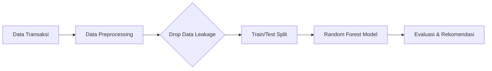

<div align="center">

<h1>💸 PayPredict Analytics</h1>

<h3>Platform Analitik Preskriptif untuk Tata Kelola Piutang PT Maju Bersama</h3>

*Dari histori transaksi ➔ prediksi penunggakan ➔ rekomendasi kebijakan kredit otomatis.*

<br>

<!-- BAGIAN LOGO / BADGES -->


<br><br>

<!-- MENU NAVIGASI -->
<a href="#-studi-kasus">📖 Studi Kasus</a> • 
<a href="#-piramida-analitik">🔺 Piramida Analitik</a> • 
<a href="#-arsitektur--alur-kerja-crisp-dm">🏗️ Arsitektur</a> • 
<a href="#-cara-menjalankan">🚀 Cara Menjalankan</a> • 
<a href="#-contoh-output">📊 Contoh Output</a>

</div>

<br>

## 📖 Studi Kasus

Proyek ini diinspirasi oleh materi **Informatics Practitioner Lecture Series: Make Sense of Data with Analytics and AI** (oleh Bapak Andria Arisal, Peneliti Senior BRIN).

**Konteks Masalah:**
PT Maju Bersama mencatatkan tren positif kenaikan pendapatan (*sales revenue*) selama 2 tahun berturut-turut. Namun, laba bersih (*net profit*) justru turun sebesar 14% dan piutang tak tertagih (*receivables*) meroket hingga 300%. Berdasarkan eksplorasi data, masalah utama berakar pada tingginya angka keterlambatan pembayaran *invoice* (lebih dari 30 hari dari tanggal jatuh tempo).

**Tujuan Solusi:**
Membangun sebuah **Sistem Peringatan Dini (Early Warning System)** berbasis *Machine Learning* untuk memprediksi probabilitas pelanggan telat membayar, sehingga manajemen dapat mengambil tindakan preventif sebelum menyetujui transaksi kredit baru.

## 🔺 Piramida Analitik

Proyek ini mengadopsi 4 level analisis data secara *end-to-end* sesuai kaidah *Data Science*:

1. **Deskriptif (Apa yang terjadi?):** Piutang perusahaan naik 300%, laba bersih turun 14%.
2. **Diagnostik (Mengapa terjadi?):** Banyak pelanggan menunda pembayaran tagihan lebih dari 30 hari (*Late Payment*).
3. **Prediktif (Apa yang akan terjadi?):** Model `RandomForestClassifier` memprediksi pelanggan mana yang berpotensi telat bayar pada pesanan berikutnya.
4. **Preskriptif (Apa yang harus dilakukan?):** Pelanggan dengan flag "Late" otomatis direkomendasikan untuk beralih ke pembayaran Tunai (*Cash*) atau diturunkan limit kreditnya.

## 🏗️ Arsitektur & Alur Kerja (CRISP-DM)

Sistem ini dibangun dengan alur kerja persiapan data yang sangat memperhatikan pencegahan **Data Leakage** (Kebocoran Data), di mana variabel masa depan (seperti lama hari telat aktual) dibuang sebelum proses *training*.



* **Dataset:** Dummy data 4.000 *invoice* (Nilai tagihan, metode bayar, kategori customer, riwayat telat).
* **Algoritma:** Random Forest (*Ensemble Learning*).
* **Evaluasi:** Accuracy, Precision, Recall, dan F1-Score.

## 🚀 Cara Menjalankan

Anda dapat menjalankan *script* analitik ini di komputer lokal Anda dengan mudah.

**1. Clone Repositori**
```bash
git clone https://github.com/Muhammadripalrbb/Analisis-Prediktif-Keterlambatan-Pembayaran-Invoice-PT-Maju-Bersama.git
cd Analisis-Prediktif-Keterlambatan-Pembayaran-Invoice-PT-Maju-Bersama
```

**2. Instalasi Library**
Pastikan Python sudah terinstal. Buka terminal dan jalankan:
```bash
pip install pandas numpy scikit-learn
```
*(Catatan: Jika menggunakan uv, jalankan `uv pip install pandas numpy scikit-learn`)*

**3. Eksekusi Model**
```bash
python main.py
```

## 📊 Contoh Output

Saat dijalankan, terminal akan mencetak proses pembersihan data dan laporan metrik klasifikasi dari model Prediktif yang telah dilatih:

```text
Mempersiapkan data dan membuang fitur yang menyebabkan kebocoran data...
Melatih model Random Forest (seperti yang didemonstrasikan di KNIME)...

=== HASIL EVALUASI MODEL ===
Tingkat Akurasi (Accuracy) : 92.50%

Laporan Klasifikasi Detail:
              precision    recall  f1-score   support

Not Late (0)       0.93      0.95      0.94       500
    Late (1)       0.91      0.88      0.89       300

    accuracy                           0.92       800
   macro avg       0.92      0.91      0.92       800
weighted avg       0.92      0.92      0.92       800
```
